<div align="center">


# Bookly

### An online bookshop for Cambodia — in English and ខ្មែរ, in dollars and riel

Browse, buy printed books and ebooks, pay with **cash on delivery** or **Bakong KHQR**,
and run the whole shop from a real back office.

[](https://github.com/danishsary8/bookly_frontend/actions/workflows/ci.yml)
[](https://github.com/danishsary8/bookly_frontend/actions/workflows/e2e.yml)


[**🛒 Live shop**](https://bookly-frontend-five.vercel.app) &nbsp;·&nbsp;
[**📖 API docs**](https://bookly-api-zasc.onrender.com/docs) &nbsp;·&nbsp;
[**💻 API code**](https://github.com/danishsary8/bookly_backend_v2) &nbsp;·&nbsp;
[**🎨 Design system**](design-system/bookly/MASTER.md)

<br />

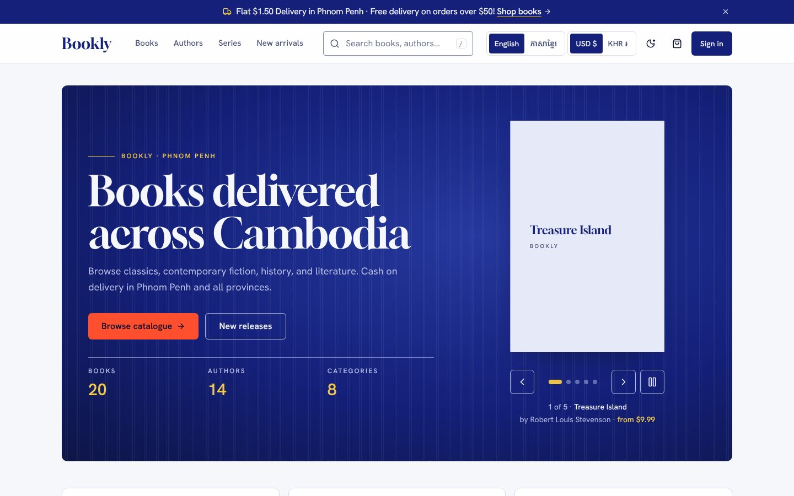

<sub>The first visit can take up to a minute: the free API server sleeps when nobody uses it.</sub>

</div>

<br />

## ✨ Highlights

<table>
  <tr>
    <td width="33%" valign="top">
      <h4>🌏 Made for Cambodia</h4>
      English and Khmer everywhere (Khmer fonts and Khmer search), prices in US dollars or riel, delivery to Phnom Penh and every province.
    </td>
    <td width="33%" valign="top">
      <h4>💳 Real payments</h4>
      Cash on delivery or a real <b>Bakong KHQR</b> code with a 15-minute timer; the page notices the payment by itself.
    </td>
    <td width="33%" valign="top">
      <h4>📖 Ebooks in the browser</h4>
      A built-in reader with saved progress, up to 3 devices and a free preview, with no file ever downloaded.
    </td>
  </tr>
  <tr>
    <td valign="top">
      <h4>🔎 Search that forgives</h4>
      Typo-tolerant search (<code>holms</code> finds Holmes), filters for age, school grade and English level.
    </td>
    <td valign="top">
      <h4>🛠️ A full back office</h4>
      39 admin pages: live dashboard, profit report, orders, stock, bulk pricing with undo, offers, support inbox.
    </td>
    <td valign="top">
      <h4>♿ Accessible by default</h4>
      Checked with axe against WCAG 2.1 AA in both languages, light and dark, from a 320&nbsp;px phone up.
    </td>
  </tr>
</table>

## 🖼️ A look around

### Shopping

| Catalogue | Book page |
| :---: | :---: |
| 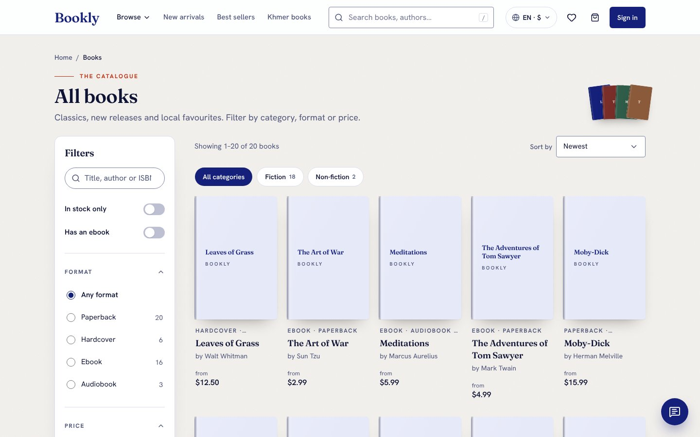 | 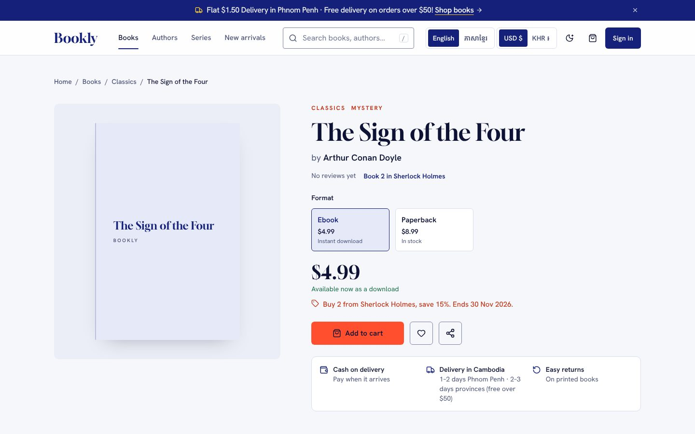 |
| **Seasonal collection** | **Cart** |
| 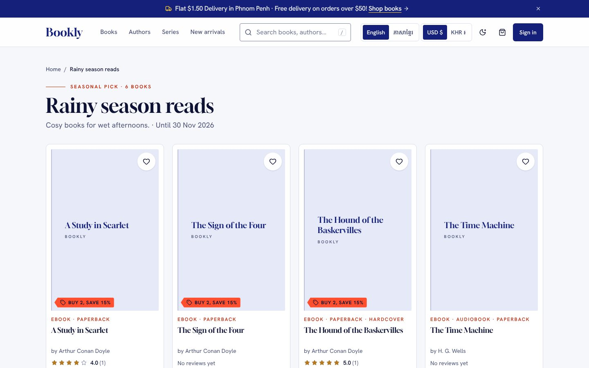 | 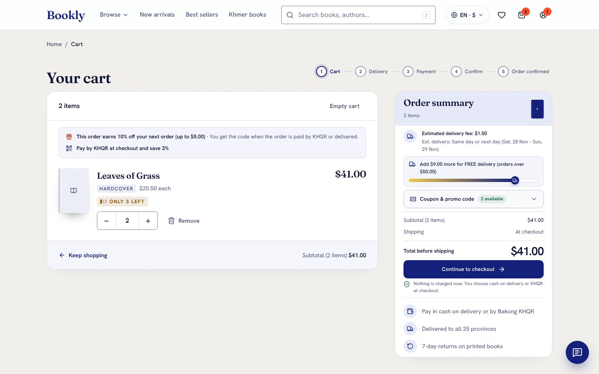 |

### Checkout and payment

| Three-step checkout | Pay with Bakong KHQR |
| :---: | :---: |
| 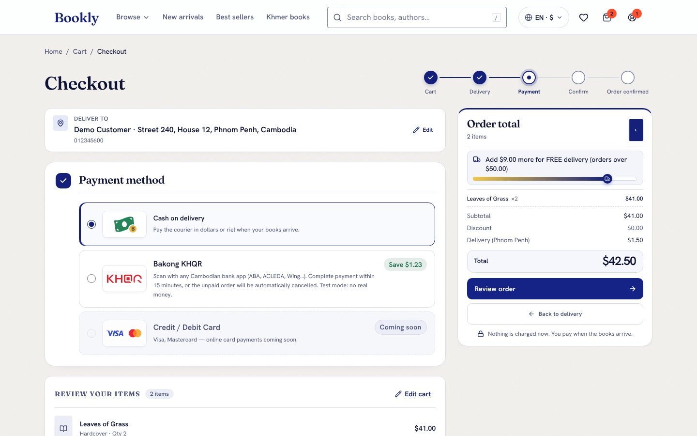 | 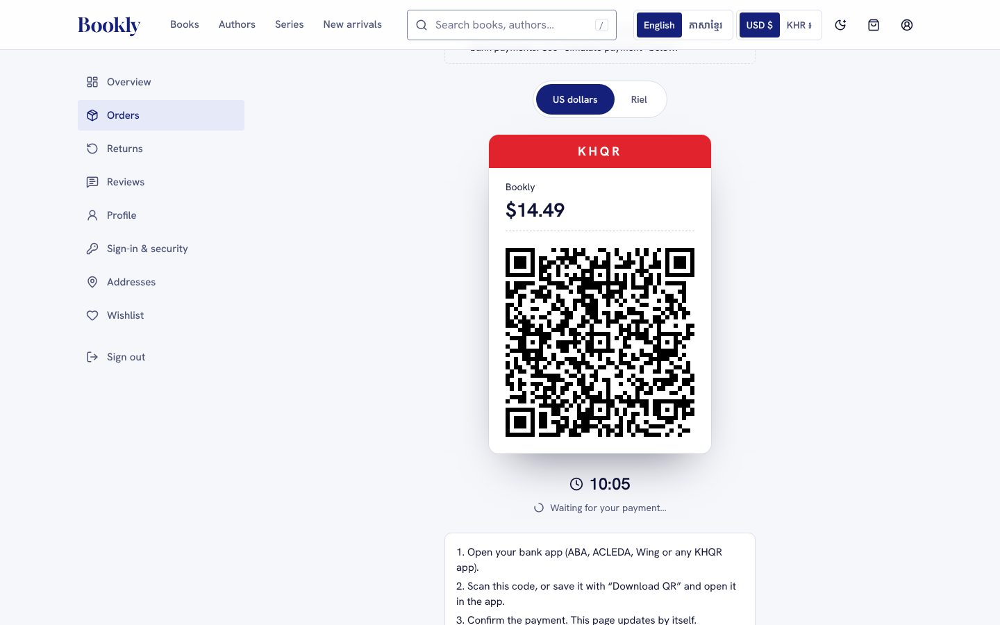 |

### Customer account

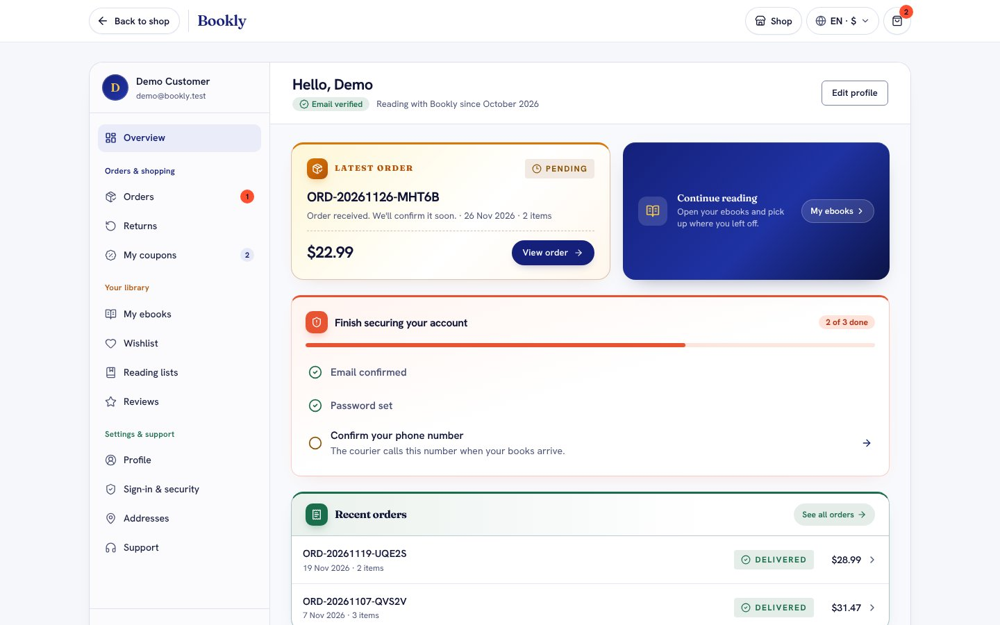

### Admin

| Dashboard | Reports |
| :---: | :---: |
| 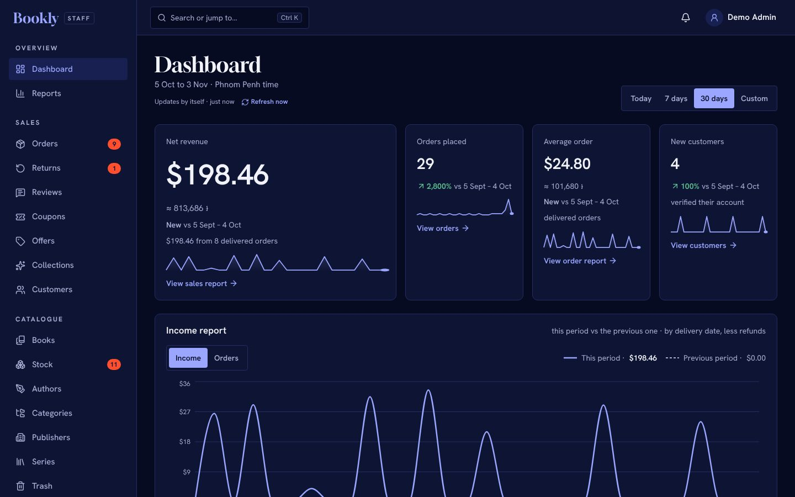 | 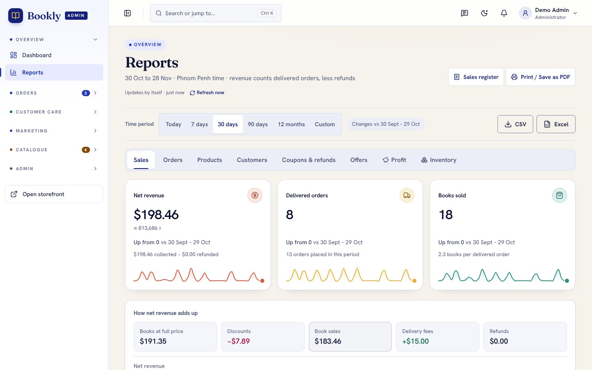 |

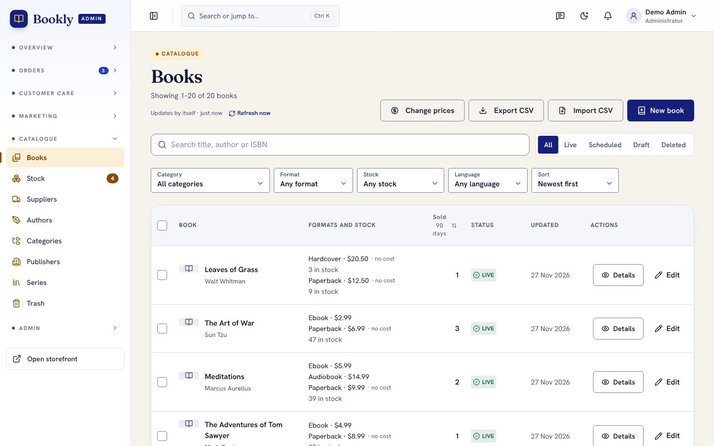

### On a phone

<p align="center">
  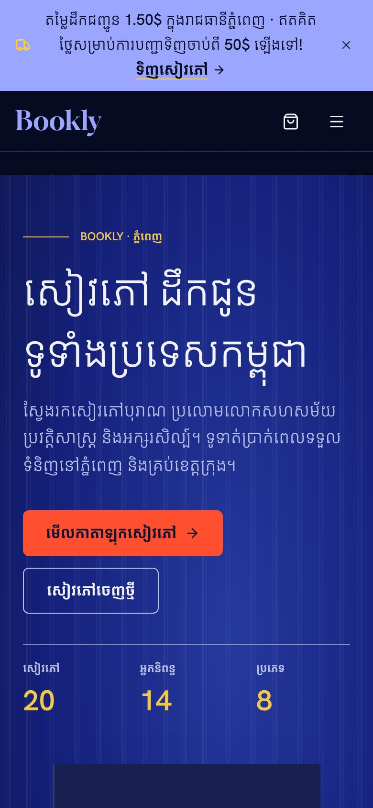
  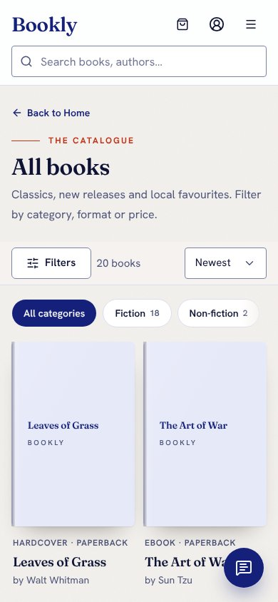
  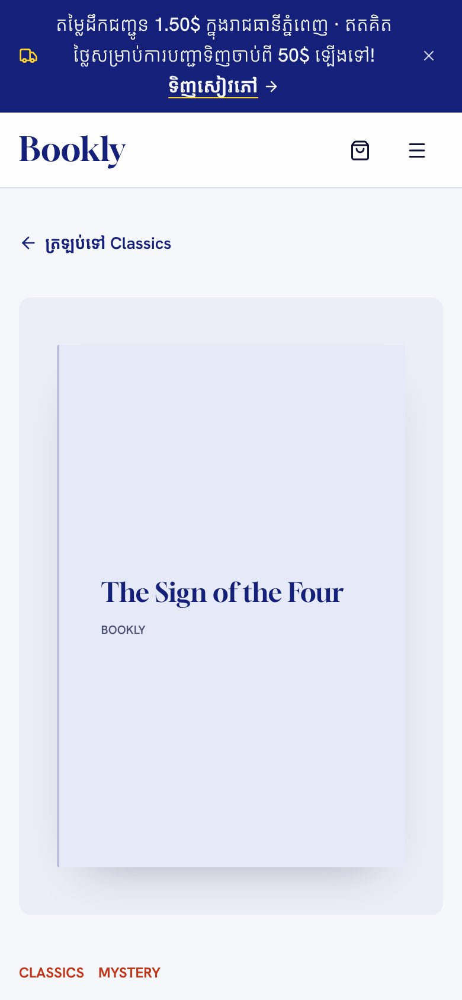
  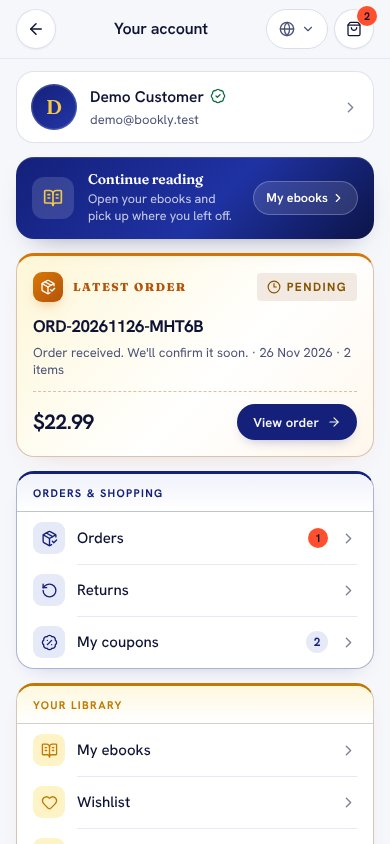
  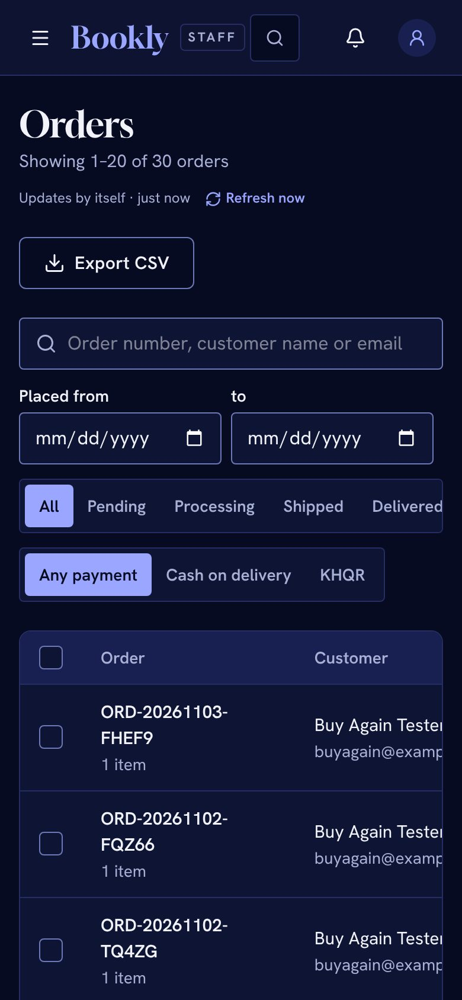
</p>

## 📊 At a glance

| | |
| --- | --- |
| **What** | A complete bookshop: catalogue, cart, checkout, payments, accounts, ebooks, support and a full back office |
| **Who it's for** | Readers in Cambodia and the staff who run the shop |
| **Size** | 95 page components (39 admin pages), 746 unit tests, 14 browser test suites |
| **Backend** | [Bookly API](https://github.com/danishsary8/bookly_backend_v2): Laravel 13 + PostgreSQL, 316 endpoints |
| **Hosting** | Vercel (site), Render + Neon (API and database), Cloudflare R2 (covers and ebook files) |

## 🚀 Try it yourself (2 minutes)

1. Open the **[live shop](https://bookly-frontend-five.vercel.app)**. Switch **English / ខ្មែរ** and **USD / KHR** at the top.
2. Search for `holms` (with a typo): you still find Sherlock Holmes.
3. Create an account (a 6-digit code arrives by email) or use **Continue with Telegram**, add a book to the cart and check out.
   Choose **Bakong KHQR**: you get a real KHQR code, a 15-minute timer and, in test mode, a **Simulate payment** button.
4. Open your order: its timeline shows every step. Staff changes appear **by themselves**, without reloading.
5. Open the **help bubble** and ask "where is my order?" or "books for a 10 year old".

<details>
<summary><h2>📋 Everything it does</h2></summary>


### 🛍️ For customers

**Finding books**
- **English and Khmer** everywhere (Khmer fonts, Khmer search), prices in **US dollars or riel**, light and dark mode, works on any phone.
- Search that forgives typos, category tree, filters for reader age, school grade and English level (CEFR), authors, series and publishers.
- Book pages with every format (paperback, hardcover, ebook, audiobook), stock, reviews, "More in this series", "More by this author",
  "You may also like" and a **Similar in theme** badge when the API's meaning-based search is switched on.
- Home page rows: best sellers, new arrivals, coming soon, ebook deals, **seasonal collections** and staff **reading lists**.
- **Pre-orders and back-orders**: buy a book before it is released or while it is out of stock, with a clear date.

**Buying**
- Cart with coupons, saved reward coupons, **offers** ("Buy 2, save 15%", "any 3 for $20" bundles, free gifts), a free-delivery bar
  and a delivery estimate.
- Checkout with **cash on delivery or Bakong KHQR**: a real KHQR code in US dollars or riel with a countdown; the page notices the payment by itself.
- Promotion pop-ups, cart reminder emails, and an optional map pin for the delivery address.

**Reading ebooks**
- Ebooks are read **in the browser** (`/read/:bookId`): page images with the reader's details burned in, reading progress
  saved, up to 3 devices, and a **free preview** of the first pages without an account.

**Account**
- Sign in with email and a 6-digit code, Google, Facebook, **Telegram**, or a code the Telegram bot sends to a confirmed phone number.
- Orders with a timeline, **buy again** in one click, cancel while pending, returns and refunds, order ratings, reviews.
- Wishlist with price-drop badges and email alerts, "tell me when it's back in stock", my ebooks, my coupons, addresses.
- Security: active sessions with remote sign-out, new-device alerts, download my data, close my account.
- **Support**: chat with the shop from the help bubble or Account → Support; guests send a short form and get replies by email.
- **Helper bot**: answers common questions, finds books and (when signed in) tells you about your own orders. It runs entirely
  inside the API, with no outside AI service.

### 🧑‍💼 For staff (`/admin`, two-step sign-in with an authenticator app)

- **Dashboard**: income, orders, average order and new customers compared with the period before, a monthly sales goal,
  charts, stock value, dead stock, repeat customers, best and slow sellers, orders by province. A printable version too.
- **Reports**: sales, orders, inventory, customers and a **profit report** (net sales − cost of books = gross profit and margin),
  with CSV and Excel export.
- Pages **update by themselves** every 30 seconds (they pause while you type), plus **Ctrl K** to jump to any order, book or customer.
- **Orders**: status steps with notes, bulk status changes, mark KHQR orders as paid, invoices, packing slips and a daily sales sheet.
- **Books**: formats, prices, cost prices, stock and **cover upload**, ebook upload, bulk CSV import/export (with a Khmer books guide),
  **bulk price change** across a filtered list (set, percent, amount or markup, rounding, never below cost) with **undo**,
  filters for margin and language, trash and restore.
- Catalogue: authors, category hierarchy with menu order and icons, publishers, series, suppliers, a purchase list for restocking.
- Marketing: coupons, offers (percent, amount, bundles, set offers, free gifts), promotions, collections, reading lists, reward rules,
  newsletters.
- Customers with tags and notes, returns and refunds, reviews and ratings, the support inbox and the helper bot's knowledge base.
- Admins only: staff members and their permissions, store settings (delivery fees, free delivery threshold, sales goal),
  payment settings, exchange rate, audit log and system health.

</details>

## ✅ Quality

- **746 unit tests** (Vitest + Testing Library) and **14 browser test suites** (Playwright) run on every push in GitHub Actions.
- **Accessibility:** pages are checked with axe against WCAG 2.1 A and AA, in English and Khmer, light and dark, from a 320 px phone
  to a 1280 px laptop. Everything works with the keyboard (skip link, focus traps, keyboard-scrollable tables), and
  "reduce motion" is respected.
- **Safe types:** the API's types are **generated from its OpenAPI file**, so a changed field shows up as a TypeScript error.
- **Defensive data handling:** responses are shape-checked, so an older API or an unexpected answer hides a panel instead of crashing the page.
- **Monitoring:** errors go to Sentry with source maps; Vercel Analytics for page views.
- **Security headers** (Content-Security-Policy and friends) are set in `vercel.json` and covered by a test.

## 🧱 Tech stack

| Area | Choice | Why |
| --- | --- | --- |
| UI | React 19, TypeScript, Tailwind CSS 4, Radix primitives, Lucide icons | Accessible building blocks, one design system |
| Routing | React Router 7 with lazy-loaded pages | Each page downloads only when it is opened |
| Data | TanStack Query 5, types generated from the API's OpenAPI spec | Caching, background refresh, safe types |
| Forms | React Hook Form + Zod | Clear errors, including the API's own field errors |
| Charts | Recharts | Dashboard and report charts |
| Motion | Motion (`LazyMotion`, loaded after first paint) | Small, and respects "reduce motion" |
| Tests | Vitest, Testing Library, Playwright, axe | Unit, browser and accessibility checks |
| Hosting | Vercel (site), Render + Neon (API + database), Cloudflare R2 (files) | Free plans that are good enough for a real shop |

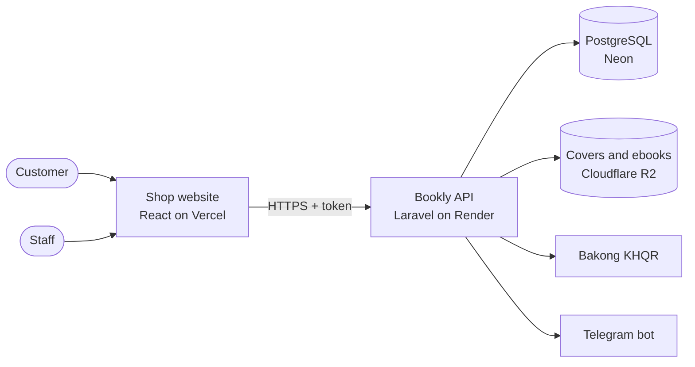

The design rules (colours, type, spacing, components) live in [`design-system/bookly/MASTER.md`](design-system/bookly/MASTER.md),
with page-specific notes in `design-system/bookly/pages/`.

## 💻 Run it on your computer

You need Node 22 and the [Bookly API](https://github.com/danishsary8/bookly_backend_v2) running locally (with its demo data),
or the live API.

```bash
git clone https://github.com/danishsary8/bookly_frontend.git
cd bookly_frontend
npm install
cp .env.example .env      # then set VITE_API_BASE_URL
npm run dev               # http://localhost:5173
```

Demo accounts (from the API's `DemoSeeder`): `demo@bookly.test` (customer), `admin@bookly.test` and `staff@bookly.test` (staff),
password `Password123!`. Staff set up an authenticator app the first time they sign in.

| Variable | What it's for |
| --- | --- |
| `VITE_API_BASE_URL` | The API, including `/api/v1`. Local: `http://localhost:8000/api/v1`. Live: `https://bookly-api-zasc.onrender.com/api/v1`. |
| `VITE_SITE_URL` | The site's public address, used at build time for `sitemap.xml`, `robots.txt` and share links. Leave empty locally. |
| `VITE_TURNSTILE_SITE_KEY` | Cloudflare Turnstile bot check on sign-up, sign-in and forms that send a code. Off when empty. |
| `VITE_GOOGLE_CLIENT_ID`, `VITE_FACEBOOK_APP_ID` | Turn on "Continue with Google / Facebook" (the API needs the matching keys). |
| `VITE_FACEBOOK_PUBLIC` | `true` once the Facebook app is published. Until then the shop notes that Facebook sign-in only works for invited test accounts. |

The local API only accepts the website from `http://localhost:5173` (its `CORS_ALLOWED_ORIGINS`), so keep that port.

**Troubleshooting:** after pulling changes, run `npm install` again if dependencies changed. If Vite reports
`Failed to resolve import "@hugeicons/react"` on `/admin`, the local packages are out of date: run `npm install` and restart `npm run dev`.

## 📜 Scripts

| Command | Does |
| --- | --- |
| `npm run dev` | Development server |
| `npm run build` | Typecheck and production build (`dist/`), plus `robots.txt` and `sitemap.xml` |
| `npm run preview` | Serve the production build |
| `npm run lint` / `npm run typecheck` | ESLint / TypeScript |
| `npm test` | Unit tests (Vitest) |
| `npm run e2e` | Browser tests (Playwright), see below |
| `npm run api:types` | Regenerate API types from the API's OpenAPI file |

## 🧪 Browser tests

`npm run e2e` drives a real browser against a running site and API (local API with demo data, site on :5173). Highlights:

- `e2e/a11y.spec.ts`: axe WCAG 2.1 A/AA on the public pages, light and dark, desktop and phone.
- `e2e/smoke.spec.ts`: keyboard basics, a customer order from book page to confirmation, and a staff member
  signing in with an authenticator code and moving that order on.
- `e2e/journeys.spec.ts` and `e2e/khmer-search.spec.ts`: longer customer journeys and Khmer search.
- `e2e/admin-smoke.spec.ts`: an isolated admin audit that intercepts every API request (no API needed).
- Also: account, credit, admin operations, catalogue management, book form, marketing, dashboard and home-loading suites.

| Variable | Default |
| --- | --- |
| `E2E_BASE_URL` | `http://localhost:5173` |
| `E2E_API_URL` | `http://localhost:8000/api/v1` |
| `E2E_CUSTOMER_EMAIL` / `E2E_CUSTOMER_PASSWORD` | the demo customer |
| `E2E_STAFF_EMAIL` / `E2E_STAFF_PASSWORD` / `E2E_STAFF_TOTP_SECRET` | the staff test is skipped without them |
| `PW_CHROMIUM` | path to an existing Chromium (otherwise run `npx playwright install chromium`) |

## 🗂️ Project structure

```
src/
  api/          API client, session, endpoints, generated types
  components/   UI kit (ui/), site shell, catalogue, forms, motion
  features/     Feature logic: auth, cart, checkout, orders, offers, rewards,
                support, assistant, promotions, account, admin …
  pages/        Route pages (shop, catalogue, account, checkout, reader, content, admin)
  routes/       Routes and guards (customer, verified customer, staff, admin)
  i18n/         English and Khmer texts
  stores/       Small stores: currency, toasts, recently viewed
  content/      Shop facts and page texts (shipping, returns, contact)
e2e/            Playwright tests
scripts/        Build helpers (API types, SEO files)
docs/           Plan, roadmap, worklog, screenshots
design-system/  Design rules (MASTER.md and page notes)
```

## ☁️ Deploying

Any static host works. It is a single-page app, so every path must serve `index.html` (`vercel.json` does this on Vercel,
and also sets the security headers). Set `VITE_API_BASE_URL` and `VITE_SITE_URL` in the host's build settings, and add the
site's address to the API's `CORS_ALLOWED_ORIGINS`.

## 📚 More docs

- [docs/V2_PLAN.md](docs/V2_PLAN.md): decisions and which page uses which API endpoint
- [docs/MANUAL_TESTING_GUIDE.md](docs/MANUAL_TESTING_GUIDE.md): how to test by hand
- [docs/ROADMAP.md](docs/ROADMAP.md) and [docs/WORKLOG.md](docs/WORKLOG.md): how the project was built, step by step

---

<div align="center">

Built with ❤️ in Phnom Penh by [@danishsary8](https://github.com/danishsary8) · a school and portfolio project

</div>
