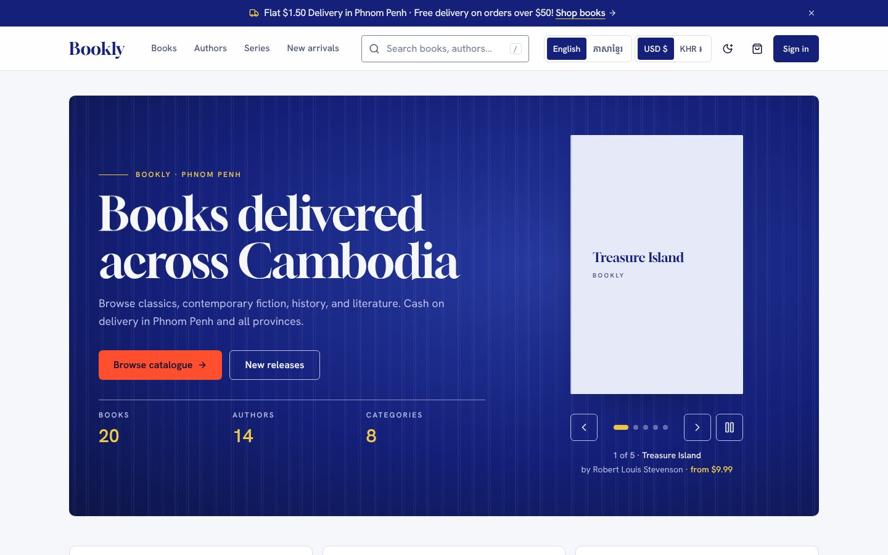
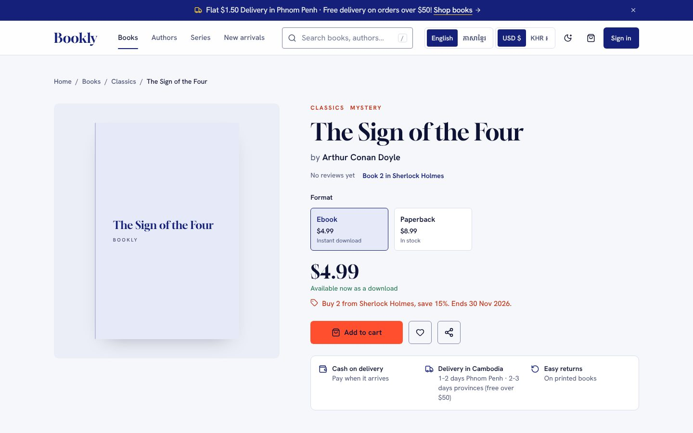
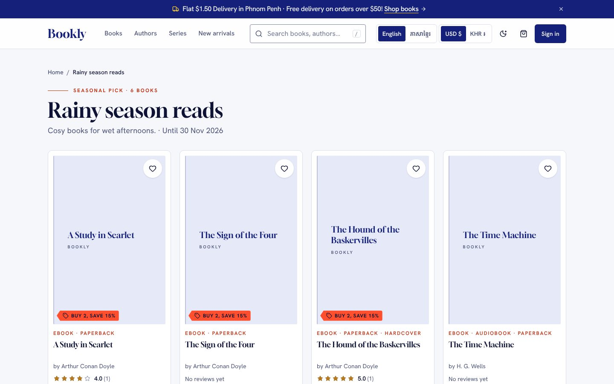
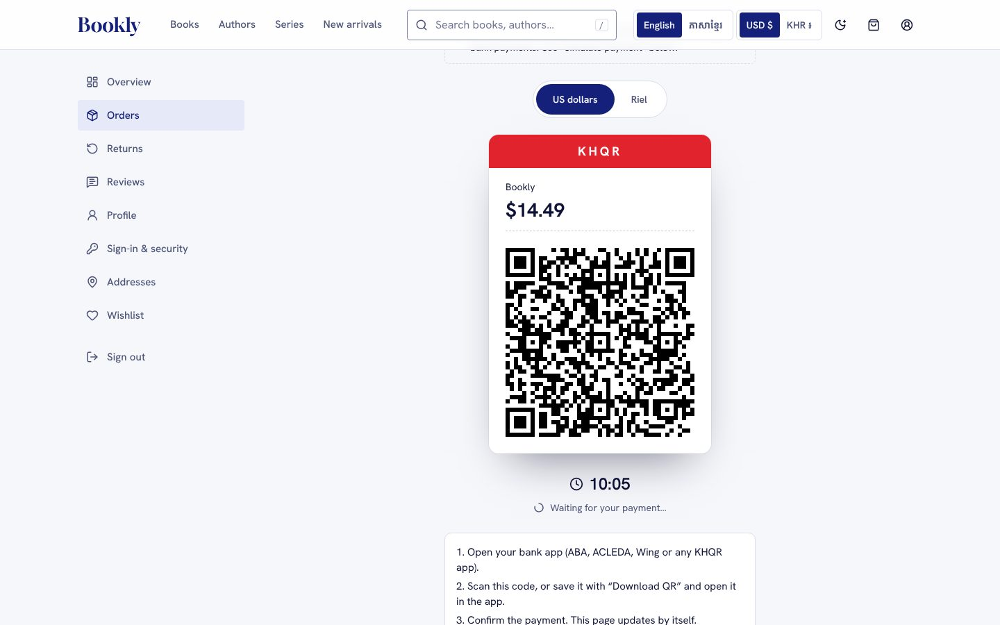
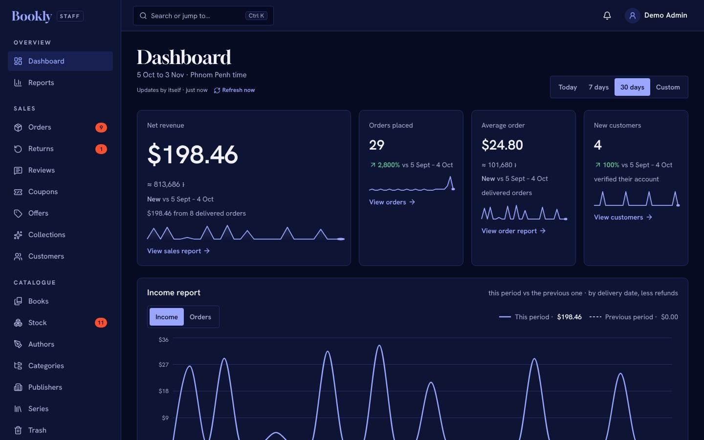
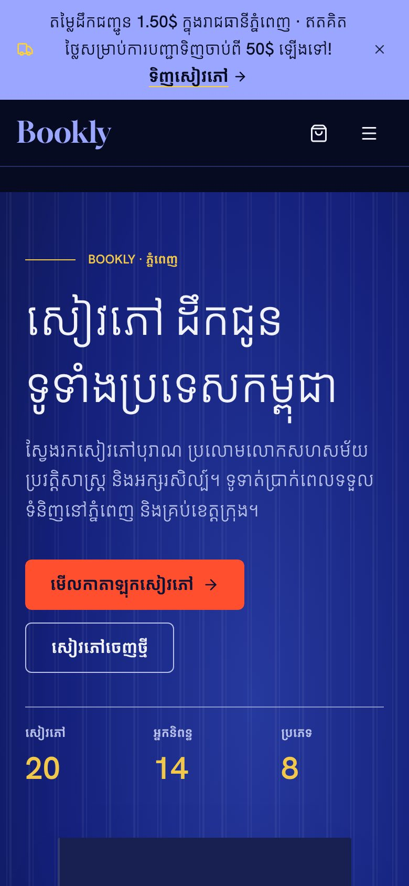
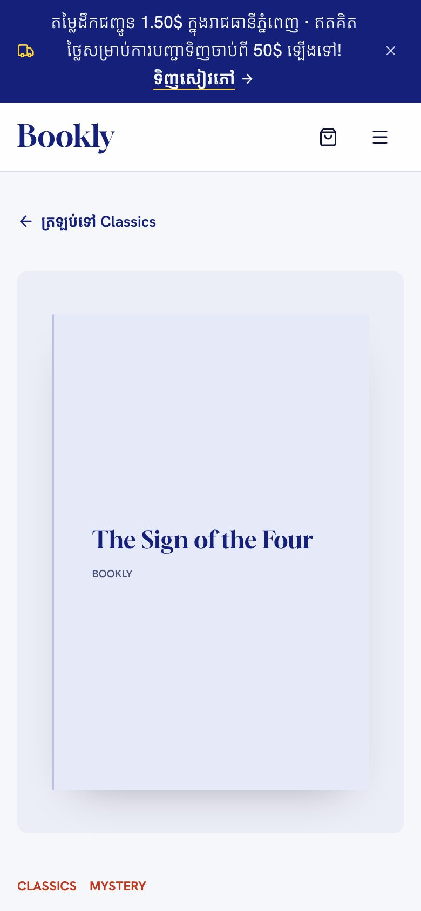
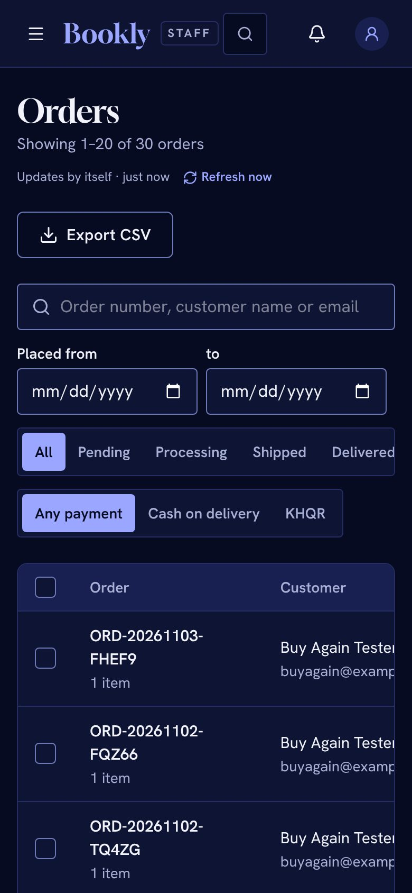
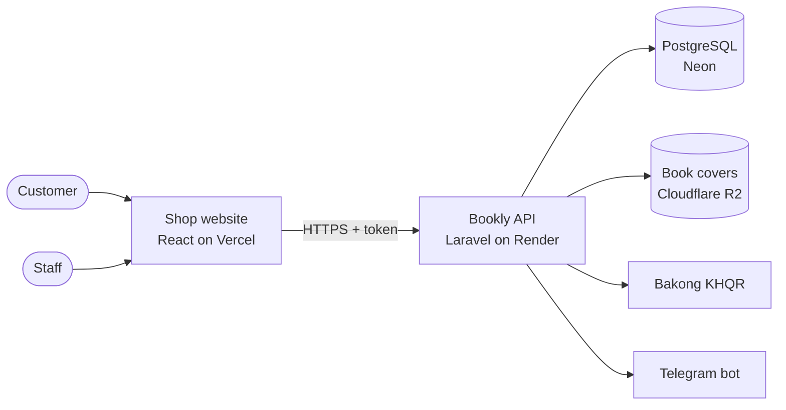

<div align="center">

# 📚 Bookly: the shop website

**An online bookshop for Cambodia, in English and Khmer.**
Customers browse, buy and pay with cash on delivery or a Bakong KHQR code. Staff run the shop from an admin area.

[](https://github.com/danishsary8/bookly_frontend/actions/workflows/ci.yml)


### [🛒 Open the live shop](https://bookly-frontend-five.vercel.app) · [▶ Live API docs](https://bookly-api-zasc.onrender.com/docs) · [💻 API code](https://github.com/danishsary8/bookly_backend_v2)

</div>



| Book page | Seasonal collection |
| --- | --- |
|  |  |
| **Pay with Bakong KHQR** | **Admin dashboard (dark)** |
|  |  |

| Phone, Khmer, dark | Phone, Khmer, light | Admin on a phone |
| --- | --- | --- |
|  |  |  |

> The first visit can take up to a minute: the free API server sleeps when nobody uses it. Book covers in the demo
> data are placeholder pictures; the screenshots show the shop's own cover design, which appears when a picture is missing.

## Try it yourself (2 minutes)

1. Open the **[live shop](https://bookly-frontend-five.vercel.app)**. Switch **English / ខ្មែរ** and **USD / KHR** at the top.
2. Search for `holms` (with a typo): you still find Sherlock Holmes.
3. Create an account (you get a 6-digit code by email) or use **Continue with Telegram**, add a book to the cart and check out.
   Choose **Bakong KHQR**: you get a real KHQR code, a 15-minute timer and, in test mode, a **Simulate payment** button.
4. Open your order: its timeline shows every step. Staff changes appear **by themselves**, without reloading.

## What it does

**For customers**
- **English and Khmer**, prices in **US dollars or riel**, light and dark mode, works on any phone.
- Search that forgives typos, filters (category, format, language, price), authors, series, publishers.
- Book pages with formats (paperback, hardcover, ebook, audiobook), stock, reviews, "More in this series",
  "More by this author" and "You may also like".
- **Seasonal collections** on the home page, and **offers** like "Buy 2, save 15%".
- Cart with coupons, free delivery above a set amount, and **checkout with cash on delivery or Bakong KHQR**
  (a real KHQR code in US dollars or riel, with a countdown; the page notices the payment by itself).
- Sign in with email and a 6-digit code, Google, Facebook, **Telegram**, or a code sent to a confirmed phone number in Telegram.
- Account: orders with a timeline, **buy again** in one click, cancel while pending, returns, store credit, reviews,
  wishlist, addresses, "tell me when it's back in stock", order updates in Telegram, print a receipt,
  download my data, close my account.

**For staff** (`/admin`, two-step sign-in with an authenticator app)
- **Dashboard** with income, orders, average order and new customers vs the period before, charts, stock value,
  dead stock, repeat customers, best and slow sellers, orders by province.
- Pages **update by themselves** every 30 seconds (they pause while you type), plus **Ctrl K** to jump to any order,
  book or customer.
- Orders (status steps with notes, mark KHQR orders as paid, CSV export, invoices and packing slips),
  returns and refunds, reviews, customers with tags and notes.
- Books with formats, prices, stock and **cover upload** (stored in Cloudflare R2), bulk CSV import, trash,
  authors, categories, publishers, series.
- Coupons, **offers**, **seasonal collections**, newsletter campaigns, reports with CSV export.
- Admins only: staff members and roles, exchange rate, audit log, system health.

## Quality

- **500+ unit tests** (Vitest + Testing Library) and browser tests (Playwright) run on every push.
- **Accessibility:** every page is checked with axe against WCAG 2.1 A and AA, in English and Khmer,
  light and dark, from a 320 px phone to a 1280 px laptop. Keyboard only works everywhere (skip link, focus traps,
  tables you can scroll with the keyboard), and "reduce motion" is respected.
- The API's types are **generated from its OpenAPI file**, so a changed field shows up as a TypeScript error.

## Tech stack

| Area | Choice | Why |
| --- | --- | --- |
| UI | React 19, TypeScript, Tailwind CSS 4, Radix primitives, Lucide icons | Accessible building blocks, one design system |
| Data | TanStack Query 5, types generated from the API's OpenAPI spec | Caching, background refresh, safe types |
| Forms | React Hook Form + Zod | Clear errors, also the API's own field errors |
| Charts | Recharts | Simple charts for the dashboard and reports |
| Motion | Motion (`LazyMotion`, loaded after first paint) | Small and respects "reduce motion" |
| Tests | Vitest, Testing Library, Playwright, axe | Unit, browser and accessibility checks |
| Hosting | Vercel (site), Render + Neon (API + database), Cloudflare R2 (covers) | Free plans that are good enough for a real demo |



The design rules (colours, type, spacing, components) live in [`design-system/bookly/MASTER.md`](design-system/bookly/MASTER.md).

## Run it on your computer

You need Node 22 and the [Bookly API](https://github.com/danishsary8/bookly_backend_v2) running locally (with its demo data),
or the live API.

```bash
git clone https://github.com/danishsary8/bookly_frontend.git
cd bookly_frontend
npm install
cp .env.example .env      # then set VITE_API_BASE_URL
npm run dev               # http://localhost:5173
```

| Variable | What it's for |
| --- | --- |
| `VITE_API_BASE_URL` | The API, including `/api/v1`. Local: `http://localhost:8000/api/v1`. Live: `https://bookly-api-zasc.onrender.com/api/v1`. |
| `VITE_SITE_URL` | The site's public address, used at build time for `sitemap.xml`, `robots.txt` and share links. Leave empty locally. |
| `VITE_TURNSTILE_SITE_KEY` | Cloudflare Turnstile bot check on sign-up, sign-in and forms that send a code. Off when empty. |
| `VITE_GOOGLE_CLIENT_ID`, `VITE_FACEBOOK_APP_ID` | Turn on "Continue with Google / Facebook" (the API needs the matching keys). |
| `VITE_FACEBOOK_PUBLIC` | `true` once the Facebook app is published. Until then the shop notes that Facebook sign-in only works for invited test accounts. |

The local API only accepts the website from `http://localhost:5173` (its `CORS_ALLOWED_ORIGINS`), so keep that port.

## Scripts

| Command | Does |
| --- | --- |
| `npm run dev` | Development server |
| `npm run build` | Typecheck and production build (`dist/`), plus `robots.txt` and `sitemap.xml` |
| `npm run preview` | Serve the production build |
| `npm run lint` / `npm run typecheck` | ESLint / TypeScript |
| `npm test` | Unit tests (Vitest) |
| `npm run e2e` | Browser tests (Playwright), see below |
| `npm run api:types` | Regenerate API types from the API's OpenAPI file |

## Browser tests

`npm run e2e` drives a real browser against a running site and API (local API with demo data, site on :5173):

- `e2e/a11y.spec.ts`: axe WCAG 2.1 A/AA on the public pages, light and dark, desktop and phone.
- `e2e/smoke.spec.ts`: keyboard basics, a customer order from book page to confirmation, and a staff member
  signing in with an authenticator code and moving that order on.
- `e2e/journeys.spec.ts` and `e2e/khmer-search.spec.ts`: longer customer journeys and Khmer search.

| Variable | Default |
| --- | --- |
| `E2E_BASE_URL` | `http://localhost:5173` |
| `E2E_API_URL` | `http://localhost:8000/api/v1` |
| `E2E_CUSTOMER_EMAIL` / `E2E_CUSTOMER_PASSWORD` | the demo customer |
| `E2E_STAFF_EMAIL` / `E2E_STAFF_PASSWORD` / `E2E_STAFF_TOTP_SECRET` | the staff test is skipped without them |
| `PW_CHROMIUM` | path to an existing Chromium (otherwise run `npx playwright install chromium`) |

## Project structure

```
src/
  api/          API client, session, endpoints, generated types
  components/   UI kit (ui/), site shell, catalogue, forms, motion
  features/     Feature logic: auth, cart, checkout, orders, account, admin
  pages/        Route pages (shop, account, checkout, content, admin)
  routes/       Routes and guards
  i18n/         English and Khmer texts
  stores/       Small stores: currency, toasts, recently viewed
  content/      Shop facts and page texts (shipping, returns, contact)
e2e/            Playwright tests
scripts/        Build helpers (API types, SEO files)
docs/           Plan, worklog, screenshots
design-system/  Design rules (MASTER.md and page notes)
```

## Deploying

Any static host works. It is a single-page app, so every path must serve `index.html` (`vercel.json` does this on Vercel).
Set `VITE_API_BASE_URL` and `VITE_SITE_URL` in the host's build settings, and add the site's address to the API's
`CORS_ALLOWED_ORIGINS`.

## More docs

- [docs/V2_PLAN.md](docs/V2_PLAN.md): decisions and which page uses which API endpoint
- [docs/MANUAL_TESTING_GUIDE.md](docs/MANUAL_TESTING_GUIDE.md): how to test by hand
- [docs/ROADMAP.md](docs/ROADMAP.md) and [docs/WORKLOG.md](docs/WORKLOG.md): how the project was built, step by step

---

Built by [@danishsary8](https://github.com/danishsary8) as a school and portfolio project.
